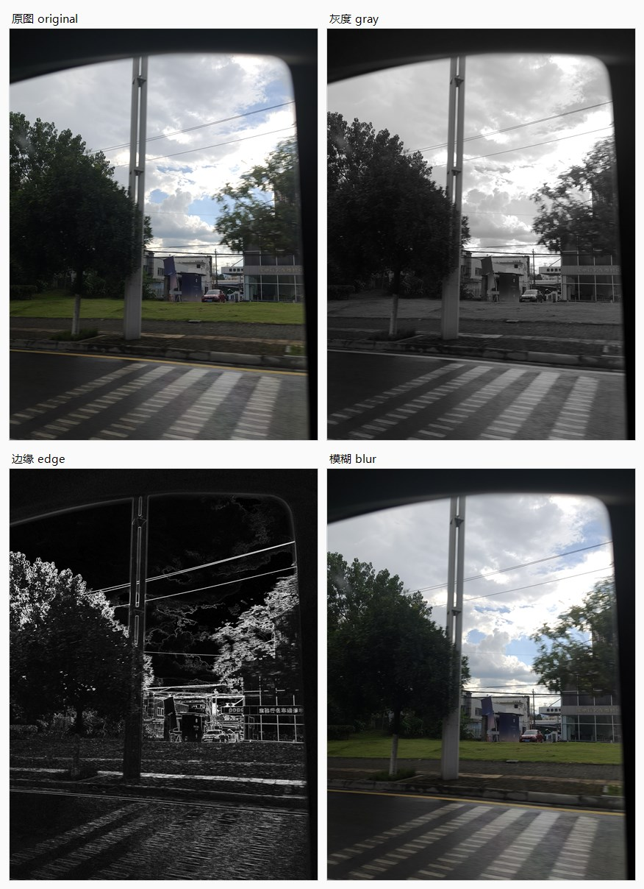

# BMP 图像滤镜工具（纯 C）

不依赖任何第三方库的 BMP 图像处理小工具，用 C 手动解析文件头、直接操作像素数组，实现灰度、反色、均值模糊和 Sobel 边缘检测。



## 编译

```bash
gcc imgfilter.c -o imgfilter.exe
```

**VS Code**：安装 C/C++ 扩展和 gcc（Windows 可用 `winget install BrechtSanders.WinLibs.POSIX.UCRT` 安装 MinGW-w64），
打开 imgfilter 文件夹后按 `Ctrl+Shift+B` 编译，或在终端直接执行上面的 gcc 命令。

## 用法

```bash
imgfilter.exe 输入.bmp 输出.bmp gray      # 灰度
imgfilter.exe 输入.bmp 输出.bmp invert    # 反色
imgfilter.exe 输入.bmp 输出.bmp blur      # 3x3 均值模糊
imgfilter.exe 输入.bmp 输出.bmp edge      # Sobel 边缘检测
```

输入输出均为 **24 位未压缩 BMP**。JPG/PNG 先用「画图」打开，另存为「24 位位图」即可。

⚠️ 注意：Win11 新版「画图」另存 BMP 默认导出 32 位（带 alpha），本程序只接受 24 位。
若报 `Only 24-bit uncompressed BMP is supported (depth 32...)`，用 PowerShell 转一次：

Add-Type -AssemblyName System.Drawing
$i=[System.Drawing.Image]::FromFile("photo.bmp")
$b=New-Object System.Drawing.Bitmap($i.Width,$i.Height,[System.Drawing.Imaging.PixelFormat]::Format24bppRgb)
$g=[System.Drawing.Graphics]::FromImage($b); $g.DrawImage($i,0,0,$i.Width,$i.Height); $g.Dispose(); $i.Dispose()
$b.Save("$PWD\photo24.bmp",[System.Drawing.Imaging.ImageFormat]::Bmp); $b.Dispose()


## 四个滤镜做了什么

**灰度**：按人眼对三原色的敏感度加权 `0.299R + 0.587G + 0.114B`，不是简单取平均。手机里的黑白滤镜也是这个系数。

**反色**：每个通道取 `255 - v`，本质是把色值在色阶上翻过来。

**均值模糊**：一个像素取周围 3x3 共 9 个像素的平均值。这就是「磨皮」最原始的形态——把局部细节抹平；成熟的美颜方案会换成保边滤波（双边、导向滤波），让脸边缘不被糊掉。

**Sobel 边缘**：用两个 3x3 卷积核分别算横向和纵向的亮度梯度，梯度越大说明这里颜色变化越剧烈，就是「边」。锐化和人像虚化的分割都用这一层信息。

## 技术点

- BMP 头用固定偏移读取，不依赖结构体对齐规则，避免了编译器 padding 导致的错位
- 像素按行 4 字节对齐（`rowBytes`），宽度不是 4 的倍数时每行末尾有填充，直接按 `width*3` 索引会错位
- BMP 像素是 **BGR 顺序、自底向上存储**，读写时都要注意
- 模糊必须先在副本上取邻域值再写回，否则一边算一边改会把刚处理完的结果当成原始像素，出现「拖影」

## 遇到的坑

1. 一开始按 `width * 3` 算行偏移，宽 241 的图整体斜着错位，才发现有行对齐填充
2. 忘了 BMP 是自底向上存的，处理完看起来像上下颠倒
3. 模糊直接原地读邻居，图像出现明显的向右下拖影，改成先 memcpy 一份源数据
4. Sobel 对边界像素越界读取，边缘一圈出现随机噪点，改成边界像素直接置 0

## 与手机影像的对应关系

| 这里做的 | 手机上的位置 |
|---|---|
| 均值模糊 | 磨皮/背景虚化的基础算子 |
| Sobel 边缘 | 锐化、虚化边缘保护、分割的前置信息 |
| 灰度加权 | 黑白滤镜、亮度统计 |

## 许可证

MIT
